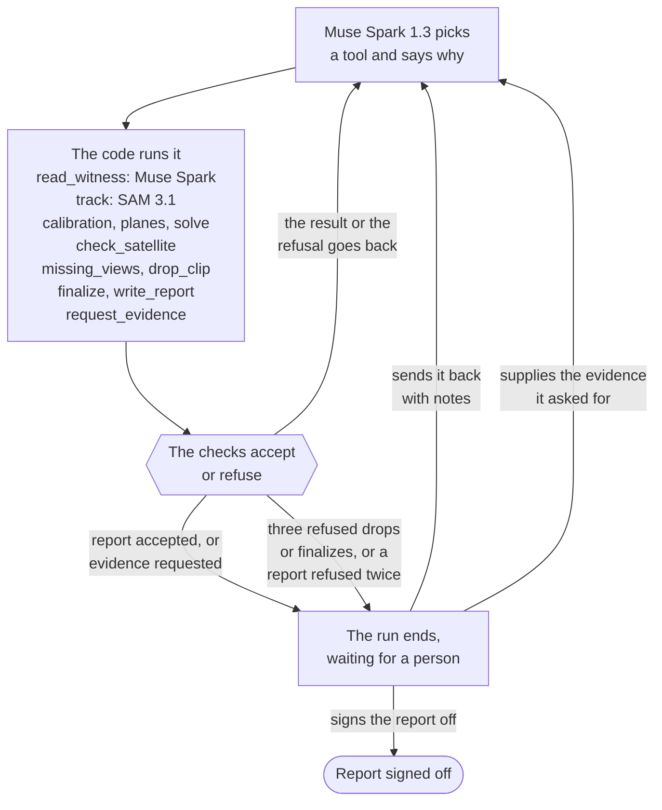

# Testigos del Bólido

**Colombia has no fireball camera network. Its phones can be one.**

When a fireball crosses the sky, people film it with phones, dashcams and security cameras. Testigos del Bólido ("fireball
witnesses") is an agent that turns those witness videos into a trajectory with error bars, a speed and a verdict: a
natural meteor, a re-entering satellite, or not enough evidence to tell. Each camera must first be oriented against
landmarks on a map, which today is an offline step (see How it works). It was checked against the published solutions
for the Chelyabinsk fireball of 2013 and pointed at a green fireball seen over Colombia on 30 July 2025, which has no
published trajectory. Today it needs cameras that stood still (a dashcam, a security camera, a phone resting on
something), and its orientation and trajectory steps have only been tested by day.

The [3D viewer](https://sadiadvertising-ship-it.github.io/testigos-del-bolido/) goes live on 31 October, and the demo
video's link is added here on 3 November. [](https://github.com/sadiadvertising-ship-it/testigos-del-bolido/actions/workflows/tests.yml)

[](https://sadiadvertising-ship-it.github.io/testigos-del-bolido/)

The Chelyabinsk validation case in the viewer, recorded by scripts/capture_replay.mjs. The replay's 12.5 s are the
fitted line flown at the fitted speed, in real time, not how long a camera saw the fireball (Kamensk-Uralskiy tracked it
for 13.7 s). As the white point descends from 89 km to 11 km, each camera's lines of sight appear: blue from
Kamensk-Uralskiy and green from Korkino, the two cameras of the solution, and grey dashed from Tyumen, which the agent
left out because its planes cross Kamensk-Uralskiy's at 7.5°. The cameras that were never oriented show as hollow dots.
The last instant holds for 0.9 s; then the still view shows the agent's white path beside the dashed yellow path of CBET
3423, the published solution, for 1.5 s, and for 1.5 s more with the 500 Monte Carlo lines as a pale blue band.

In the viewer, the side panel opens with one of the witness videos the agent measured, Tyumen's dashcam: its uploader's
own video in YouTube's player, which loads only when you press play. One press runs the 3D replay with it from the same
instant, so the footage and the path it became play side by side. Tyumen is the camera the agent left out of the fit
(its planes cross Kamensk-Uralskiy's at 7.5°), which also makes it the check: its lines of sight miss the fitted path by
0.43° RMS. Kamensk-Uralskiy's uploader does not allow the video on other sites, so the viewer links to it. The GIF above
and the demo video leave the window out.



The Global Meteor Network's report for 2025 counts the cameras that produced meteor orbits that year: 36 in Brazil, 11
in Mexico, 2 in Chile and none in Colombia (Roggemans et al. 2026, Table 5). When a fireball crosses Colombia, the videos
people post may be the only record from the ground.

Built during the Meta Global AI Developer Hackathon (26 October to 4 November 2026) with Muse Spark and SAM 3.1.
The 3D viewer runs from this repository: `python3 -m http.server -d web 8000`, then open http://localhost:8000.

## How it works

1. **Muse Spark reads each video**: camera type, edits, on-screen clock, when the fireball shows, and landmarks a map
   could locate (`src/testigos/witness.py`).
2. **SAM 3.1 tracks the fireball** frame by frame from the phrase "bright light"; on the two clips where other phrases
   were tried (Beloretsk and Chebarkul), "fireball" and "meteor" returned nothing, and so did "light streak" on
   Chebarkul (`track.py`). The agent runs it itself on any clip nobody has tracked yet.
3. **Each camera is oriented** from lines and landmarks in one frame: a camera model (pinhole with radial distortion) is
   fitted to them and to OpenStreetMap, so every pixel becomes a direction in the sky (`camera.py`). This step is not
   automated in the product yet. During development an AI coding assistant (Claude Code, not a Meta model) did it: two
   independent annotation passes measured street lines and poles from intensity profiles, and the assistant matched the
   landmarks and street bearings to OpenStreetMap. No person checked the points by hand.
4. **Planes of sight.** One camera's lines of sight to the fireball lie in a plane. Two cameras on different sides give
   two planes that cross in the trajectory, refined by least squares over every ray (`solve.py`; Ceplecha 1987,
   Borovička 1990). The speed comes from each video's own frame times.
5. **Verdict.** Nothing that orbits the Earth can enter the atmosphere faster than Earth's escape speed, 11.2 km/s (from
   a low orbit, satellites and rocket stages enter at about 7.8 km/s), and anything that orbits the Sun enters faster. So
   the verdict is natural if the speed's 95% range lies above 11 km/s; re-entry if it lies below 8.5 km/s and the passage
   is long; inconclusive otherwise (`verdict.py`). The range is the Monte Carlo's when there is one, else the speed ± 2σ
   with σ at least 10% of the speed.

## The agent

The handbook of the hackathon's agent workshop says it in one line, "An agent is a model that uses tools in a loop"
(`HANDBOOK.md` in github.com/meta-models/legal-agent-workshop): the model decides which tool to call, the code carries
the call out and keeps the record, and checks outside the model decide whether the work may move on. That is how the
case agent works (`src/testigos/agent.py`):

- **Planner.** Muse Spark 1.3 calls the tools natively on `/v1/responses`, one call per turn, with the whole
  conversation sent each turn. It is told the rules of the case, not an order of steps.
- **Tools.** `read_witness` (Muse reads a video), `track` (SAM 3.1, run on any clip nobody has tracked), `calibration`,
  `planes`, `solve`, `check_satellite` (NASA's GLM bolide catalogue), `missing_views`, `drop_clip`, `finalize`,
  `write_report`, `request_evidence`.
- **Checks inside the tools, which the model cannot skip:**
  - `drop_clip` leaves a camera out only on a criterion the code measures: the weaker of a near-parallel pair (its
    planes cross a kept camera's under 10°, and that camera crosses the rest more widely), planes that cross every kept
    camera's under 10°, or a rise of every other camera's residual by more than 25% and 0.1°.
  - `finalize` re-solves the chosen cameras and refuses them when an oriented camera was left out without an accepted
    drop, when a much wider pair was left aside, or when an added camera raises every other camera's residual.
  - `write_report` writes the report in English and Spanish. Every figure must match a tool result of the run, and one
    printed with a unit must match a result of that kind: a convergence angle cannot pass as a speed (`verify.py`). Hemisphere letters must agree, and
    the text must not state a verdict other than the code's, which the code writes at the top. An open case's report
    waits until the satellite detections and the towns were checked. Refused drafts stay in the run record.
  - `request_evidence` stops the run until a person supplies videos, a camera position or a landmark confirmation, and
    is refused while the evidence at hand is enough.
  - Three refused drops, or three refused finalizes, stop the run for a person; a report that fails its check twice
    stops it at once.
- **A person at the end.** A run ends waiting for review (`python -m testigos review … --approve`) or for the evidence it
  asked for. A reviewer can send the report back with notes, and can withdraw a signature the same way; the history keeps
  every entry. A blocked run does not call the model again until one of its inputs changes or a reviewer sends notes
  (`python -m testigos resume`), and the notes reach both the planner and the model that writes the report.
- **Records.** Every run is kept in `events/<id>/runs/<run_id>.json`, never replaced by a later run (a review only changes its status and adds to its history): code version, hashes of every
  input, model, each step with its reason and result, the checks, refused drafts and the API cost.
  `python -m testigos replay <event> <run_id> --echo` re-runs a recorded run's tools offline and lists any difference.
- **The answer is out of reach.** The published solutions and every comparison with them live in `validation/`; a test
  fails if anything in `src/` reads them, and no agent input holds a published value or a comparison with one, although
  the camera fits and the Monte Carlo's field-of-view range were settled with CBET in view (see What these numbers do not
  say). `scripts/grade.py` grades a run afterwards.

What the agent did on Chelyabinsk (run `20261027T220006-4e3e`, 14 steps, US$ 0.07):

```
01  calibration   2         oriented        (03: 48 oriented, 04: 10 oriented)
02  planes                  Q: 2-10 66.3°, 48-10 58.9°, 2-48 7.5°
05  solve         2+10      282.1° heading, 17.5° slope, 19.65 km/s, natural
06  drop_clip     48        near_parallel_pair, confirmed by the code: its planes cross Kamensk's at 7.5°,
                            and Kamensk crosses Korkino at 66.3° against Tyumen's 58.9°
07  calibration   14        not oriented    (08 to 12: drop_clip 14, 15, 81, 257, 238, not_oriented, confirmed)
13  finalize      2+10      accepted by the code
14  write_report            figures traced: es 22 of 22, en 23 of 23 -> awaiting review, then signed off
```

This is the fourth complete run of the tool-calling agent on this case (an earlier attempt, `20261027T132145-7dce`, failed on an API error after three
steps). Every review is kept in the run record's history. What happened, run by run, on 27 October 2026:

- **`20261027T132419-a996`** chose the same cameras. It dropped Tyumen citing its 7.5° crossing with Kamensk-Uralskiy and a
  rise in residuals that was under the code's own threshold, because the code then checked only that the reason quoted numbers from the tools. Its report gave
  ±0.29 km/s as the speed's uncertainty (the spread between the two cameras' speeds) and called the geometry solid.
  Diego Burbano signed it off at 13:55. That evening a review by the AI coding assistant found both problems. Drops now
  need a criterion the code measures, the verdict and the report read the Monte Carlo's range, and the run was resumed
  with notes. The code could not withdraw a signature then, so a996's record still shows it signed. Replayed with today's
  code, its drop is refused because it names no criterion, and its `finalize` is then refused. The rise it cited also
  fails today's `raises_residuals` test: 4% for Kamensk-Uralskiy and 13% for Korkino, under the 25% the code requires
  (`validation/chelyabinsk-2013/drop-48-criteria.json`).
- **`20261027T183453-9c57`** passed every check, and its Spanish report still said the uncertainty came from a short
  baseline. That is false: the two cameras are 173 km apart and their planes cross at 66°. No figure was wrong, so no
  check could catch it. The coding assistant flagged the sentence, and Diego Burbano sent the report back at 18:57
  (`review --reject --notes`).
- **`20261027T185758-cee8`** left the sentence out, and Diego Burbano signed it off at 19:02. Two problems came out
  later that night. Notes then reached only the planner, not the model that writes the report, so the sentence had gone
  without the writer seeing them; now the notes reach both. And a claims check by the coding assistant found that the
  English report said two cameras could be oriented, when three were. Diego Burbano withdrew his signature at 21:59
  (`review --reject` on a signed run, which the code now allows), and the report facts now list the cameras oriented,
  used and set aside.
- **`20261027T220006-4e3e`**, above, resumed with his note. Its reports name the three cameras and why Tyumen was set
  aside, and he signed it off at 22:06.

## Validation: Chelyabinsk, 15 February 2013

The case holds eight witness videos chosen from the Ondřejov catalogue of Chelyabinsk videos (Borovička et al. 2016),
which also gives each camera's position: stopped cars and fixed cameras, with buildings or streets in view. Muse later
reported camera motion in three of them (Beloretsk, Chebarkul and Magnitogorsk), and none of those three could be
oriented, and neither could Yekaterinburg or Plast (Plast's fit was set aside after it missed CBET's plane by 9.3°).
Two more chosen from the catalogue, Verkhnaya Pyshma and Mezhozernyi, were no longer online and are not among the
eight. Three of the cameras could be oriented: Kamensk-Uralskiy (a stopped car),
Korkino (a standing car) and Tyumen (a car at a traffic light). The agent kept Kamensk-Uralskiy and Korkino, 173 km
apart, whose planes cross at 66°, and left Tyumen out as the weaker of a near-parallel pair: its planes cross
Kamensk-Uralskiy's at 7.5°.

In everyday terms: the stretch the two cameras saw, from 89 km down to 11 km, is 246 km long, about as far as Bogotá is
from Medellín in a straight line (245 km between the points Wikidata gives for the two cities), and Kamensk-Uralskiy's
camera followed the fireball from 89 km down to 12 km in 13.7 s. CBET's major flare sits 29 km up on our fitted line,
about three times as high as an airliner cruising at 10 km. And even the low end of the Monte Carlo's 95% speed range,
12.1 km/s, is faster than anything that orbits the Earth can enter the atmosphere: it was a rock from space, not space
junk (`scripts/export_web.py` computes these comparisons for the viewer).

| | This agent | CBET 3423 | Refereed, 2013 | Zuluaga, Ferrín & Geens |
|---|---|---|---|---|
| Heading (azimuth of motion) | 282.1° by the fit; Monte Carlo median 279.3° (1σ 275.8–282.6°) | 279.5° | | 285° |
| Slope below the horizontal, at the end point | 17.5° by the fit; Monte Carlo median 17.0° (1σ 16.4–17.6°) | 16.5° | 17° at the end and 18.5° at the start (Borovička); 18.3° at entry (Popova) | 15.8° |
| Speed | 19.65 km/s by the fit; Monte Carlo median 17.6 km/s (1σ 14.9–20.3) | 17.5 ± 0.5 km/s | 19.03 ± 0.13 (Borovička) and 19.16 ± 0.15 km/s (Popova) | |
| Height where CBET puts the major flare | 29.2 km on our fitted line; Monte Carlo median 29.4 km (1σ 24.9–34.0) | 31.7 km | peak radiation at 29.7 km (Popova) | |
| Distance from CBET's end point to our line | 3.7 km by the fit; Monte Carlo median 7.0 km (1σ 3.8–10.8) | | | |

The refereed values are Borovička et al. (2013, Nature) and Popova et al. (2013, Science); CBET 3423 was the preliminary
telegram of Borovička's team. Neither paper's full text was read here: each value was read in a later paper that cites
it, a press release, or a search-engine excerpt of a PDF (for Popova's 18.3°, of the paper itself), as named in
`validation/chelyabinsk-2013/refereed.json`. The Monte Carlo
(`scripts/montecarlo.py`, 500 draws) re-fits both cameras from perturbed evidence
on every draw: line and landmark pixels, street bearings, camera positions (8 m), Korkino's field of view (anywhere from
76 to 95°) and distortion, the SAM points, and each camera's clock. Its median heading sits 2.8° below the fit's; the
field of view it draws averages 85.5°, wider than the fit's 79.5°, and a wider field of view lowers the heading (91.9°
gave 275.9°: `validation/chelyabinsk-2013/history/solution-2-10-v2.json`).

`scripts/grade.py` graded the run afterwards. Four criteria were committed on 26 October at 20:33, before the first
camera was calibrated at 21:25: heading within 3°, slope within 3°, height at CBET's major flare within 5 km and CBET's
end point within 15 km of our line. All four pass. A speed criterion, within 1.5 km/s of CBET's 17.5 km/s, was added on
27 October, after the 19.65 km/s fit was on record, and it fails (4 of 5). A fifth criterion written on 26 October, a
calibration residual under 0.3°, is not graded: the internal fits pass it, and Korkino's 3.39° from CBET's plane would
not. Against the refereed speeds, a comparison added after the first graded run (a996), the fit's 19.65 km/s is within
0.62 km/s.

Three checks that do not use any published value:

- **Tyumen, held out.** Its 223 lines of sight miss the Kamensk-Uralskiy and Korkino path by 0.45° (median; 90% within
  0.54°), and its own clock gives 19.17 ± 0.08 km/s along it (`scripts/holdout.py`). Its camera was refitted after
  it missed CBET's plane by 3.4°, so this check is independent of the fit, not of CBET.
- **Why Tyumen is out.** Kamensk-Uralskiy's and Tyumen's planes cross at 7.1° in the median Monte Carlo draw and at 3.1°
  in the narrowest, and their rays can pull the fit along their shared plane (the draws that slide have a median of 6.2° between those planes,
  the others 7.7°). With all three cameras, 51 of 200 draws end
  more than 10° from that fit's own heading or below a 12° slope (62 measured from the two-camera heading); with
  Kamensk-Uralskiy and Korkino, 4 of 500 do (`scripts/mc_stability.py`).
- **SAM against a brightness threshold.** The numpy baseline that runs beside SAM, fed to the same solver on the same
  frames, gives a heading of 303.7° and a speed of 0.01 km/s for the same two cameras: it follows the glare. With all
  three cameras it gives 290.5° and 19.15 km/s. With SAM's points, the same two cameras give 282.1° and
  19.65 km/s, and all three 278.5° and 19.49 km/s (`scripts/sam_vs_threshold.py`). The baseline is a plain threshold, not a tuned tracker.

What these numbers do not say:

- **The validation is blind for the agent, not for the calibration.** The camera fits were made with CBET in view.
  Kamensk-Uralskiy was checked against CBET's plane as soon as it was fitted. Tyumen was recalibrated after missing
  CBET's plane by 3.4°, and Plast was left without a camera after missing by 9.3°. Korkino's field of view was settled
  while the pair was graded against CBET: a self-calibration at 91.9° turned the heading to about 276° and failed the 3°
  criterion, then 78.8° missed it by 0.04° and 79.5° passed, both committed at 22:40 on 26 October (39492ef). 79.5° is the value
  where Korkino's speed agrees with Kamensk-Uralskiy's, and its rays sit 3.4° from CBET's plane, about as far as
  Tyumen's before its refit (`validation/chelyabinsk-2013/history/`, `calibration-vs-cbet.json` and
  `calibration-checks-vs-cbet.json`).
- **The Monte Carlo's range for that field of view was widened after a run.** On 27 October a 500-draw run with
  N(79.5°, 2.5°) left CBET's slope outside its 2σ range and its heading outside 1σ. The range was then widened to 76 to
  95°, which covers the three fitted values, 78.8°, 79.5° and 91.9°, and CBET's heading and slope now fall inside 1σ.
- **The head point changes definition mid-track.** It is the leading end of a streak and the centre of a round glow.
  Split where SAM's box stops being longer along the motion (10.1 s), Kamensk-Uralskiy's points give, with Korkino, a
  15.8° slope and 16.7 km/s before the change and 20.2° and 19.1 km/s after it (`scripts/head_split.py`). The Monte
  Carlo does not draw this choice.
- **One validated case.** Iberia 2024, a night fireball planned as a second check, was not attempted.

## Open case: Colombia, 30 July 2025

At 10:50 pm Colombian time a green fireball crossed the sky. The Geostationary Lightning Mapper on GOES-19 recorded a
1.05 s flash at 6.46° N, 72.21° W, which NASA's analysts classified as a bolide, with medium confidence and lightning
nearby. NASA's GLM bolide catalogue was kept all year from 2020 to 2025. In those six years it lists 42 events inside a
coarse outline of mainland Colombia (40 to 54 when the outline is moved 30 km in or out), 4 to 13 a year, and rates 35 of them low confidence. For 3 of them, all in 2025, GOES-East saw the
flash within 2° of sun glint, so they may be sunlight reflected by water or a roof rather than bolides
(`scripts/glm_by_country.py`, `events/colombia-2025-07-30/glm-colombia.json`). A Colombian team documented the
fireballs of 31 May 2024 (Araujo-Salcedo et al. 2024, a poster at the VIII Colombian Congress of Astronomy).

The only video analysed so far was filmed in Medellín, 373 km away: a handheld phone video that replays the moment in
cuts. The agent ran SAM 3.1 on it, which found the flash in 79 of 132 frames, but nothing in view can be located on a
map and the filming spot is unknown, so the camera cannot be oriented. Security-camera and dashcam clips from Bogotá and
Medellín, posted on X by @ColombiaOscura (x.com/ColombiaOscura) on 1 August 2025, have not been analysed yet.

Was it space junk? No satellite or rocket re-entry in the Aerospace Corporation's CORDS database has a predicted window
that includes the flash. The nearest window, OBJECT C's (07:54 UTC on 31 July, ± 2 hours), opens 2.1 hours after the
flash, and STARLINK-2038's (18:42 UTC on 30 July, ± 1 hour) closed 8.1 hours before it
(`events/colombia-2025-07-30/reentries.json`). The database lists tracked objects only, so the speed still has to
decide (a rock from space enters the atmosphere faster than 11.2 km/s; a satellite or rocket stage falling from a low orbit,
at about 7.8 km/s), and the speed needs a trajectory.

With fewer than two oriented cameras the agent reports insufficient geometry and asks for what would close it: videos
from Málaga, Saravena and San Gil, where the flash would have stood about 21° to 51° above the horizon. Run
`20261027T215525-b8d0` (6 steps, US$ 0.05) is blocked waiting for them (`events/colombia-2025-07-30/requests.json`). The
agent tracked the Medellín clip with SAM 3.1 itself in an earlier run, `20261027T183335-867d`:

```
    track            medellin   SAM 3.1: the flash in 79 of 132 frames, window 1.2-4.2 s     (run 867d)
01  calibration      medellin   not oriented
02  finalize                    accepted: insufficient geometry
03  check_satellite             1 GOES-19 detection; no re-entry window includes it
04  missing_views               towns: Málaga, Saravena, San Gil, Pamplona
05  write_report                figures traced: es 18 of 18, en 22 of 22
06  request_evidence            blocked: waiting for videos from Málaga, Saravena and San Gil
```

Three earlier reports of this case were wrong without a wrong figure. Run `20261027T132811-1934` wrote its report before
checking the satellite, and the report spoke of two submitted videos, from Bucaramanga and Medellín. Runs 867d and
`20261027T184659-28c2` said there was no Bucaramanga video because the account had been suspended. That post never had a video:
it was text only, and the case's note did not say so plainly. An open case's report now waits for both checks, its
facts say which clips have a video, and run b8d0 resumed 28c2 with the corrected note and the notes of a claims check by
the AI coding assistant.

Separately, on 27 October the author asked Colombian astronomers to review the method and that day's preliminary
results, and for videos of the fireball; none has reviewed them yet.

## Built during the hackathon, and what came before

Everything in this repository was written during the event: the first commit is from 26 October 2026, 20:25 Colombian
time, after the kickoff, and the code was written with an AI coding assistant (Claude Code). What came before: the method
(Ceplecha 1987; Borovička 1990), the published solutions used to grade (CBET 3423; Borovička et al. 2013; Popova et al.
2013; Zuluaga, Ferrín & Geens 2013), the Ondřejov catalogue of camera sites (Borovička et al. 2016), OpenStreetMap,
NASA's GLM bolide catalogue, the Aerospace Corporation's CORDS re-entry listings, and the witness videos, which belong to
their authors.

## Meta models

| Model | Used for |
|---|---|
| `muse-spark-1.3` | the agent's planner, with native tool calling; the reports; retries when 1.2 loops |
| `muse-spark-1.2` | reading the witness videos under a strict JSON schema |
| `sam-3.1` | tracking the fireball through each video, inside the agent's loop when a clip is new |

What Muse saw, against what was measured later: in Kamensk-Uralskiy it named the chapel the orientation depends on and
put it at 0.89 of the frame's width, where the point matched to OpenStreetMap sits at 0.884, about 7 pixels away (only
the column compares: the marked point is the chapel's base); it read the dashcam clock as 09:20:18 at the start of the
clip, within a few seconds of CBET's time in local hours; in Korkino it read a clock 22 minutes off,
an example of why the method, from its first commit, uses each video's frame times and never its clock; in Tyumen it missed the power tower the
orientation uses. Muse Spark 1.2 ran to its token cap on 4 of its 11 video reads; a retry recovered each of them, Tyumen's on the next day's run.

API spending is capped in code (`TESTIGOS_BUDGET_USD` a day, `TESTIGOS_TOTAL_BUDGET_USD` in total) and logged per call in
`out/costs.jsonl`: US$ 2.73 for the whole project so far.

## Run it

```
python3 -m venv .venv && .venv/bin/pip install -U pip && .venv/bin/pip install -e '.[test]'
.venv/bin/python -m pytest                          # offline: geometry, report check, agent checks, replay
.venv/bin/python -m testigos replay chelyabinsk-2013 20261027T220006-4e3e --echo   # the agent's tools again, no API key
.venv/bin/python scripts/grade.py chelyabinsk-2013  # grades the newest run against validation/
.venv/bin/python scripts/triangulate.py 2 10        # the two-camera solution and the CBET gate
.venv/bin/python scripts/holdout.py                 # Tyumen as a held-out witness
.venv/bin/python scripts/sam_vs_threshold.py        # SAM 3.1 against a brightness threshold
.venv/bin/python scripts/mc_stability.py           # Monte Carlo draws that slide, with Tyumen and without it
.venv/bin/python scripts/drop_criteria.py          # Tyumen's four drop criteria, measured by the agent's code
.venv/bin/python scripts/head_split.py             # Kamensk-Uralskiy's head point, before and after it changes
.venv/bin/python scripts/glm_by_country.py         # GLM events over Colombia per year (needs scripts/fetch_glm.py)
.venv/bin/python scripts/montecarlo.py 500 2 10     # the uncertainty (about a quarter of an hour)
.venv/bin/python scripts/export_web.py && python3 -m http.server -d web 8000
```

Running the agent itself needs a Meta Model API key: copy `.env.example` to `.env`, fill in `MODEL_API_KEY`, then
`.venv/bin/python -m testigos run chelyabinsk-2013` (US$ 0.04 to 0.13 a run so far). The demo cards need Pillow
(`pip install -e '.[demo]'`, then `scripts/track_cards.py` and `scripts/title_cards.py`).

## Data, credits and privacy

The witness videos are not in this repository, and neither are their frames. `events/<id>/credits.json` names each
video's source, uploader, permission status, whether its uploader allows embedding, and where its camera position comes
from. This repository publishes no frame and no audio: only numbers and text measured from the videos (SAM's pixel tracks, the annotated line and landmark pixels,
and Muse's structured readings). Muse's readings keep no transcript of what the witnesses say; three short transcripts
were in commits f88a059 to 54d2875 and remain in the history. The Chelyabinsk camera positions are the Ondřejov
catalogue's as published (cars on public roads and security cameras), and the viewer rounds them to about 100 m. For
new witnesses, the filming spot is published rounded to about 100 m, and the exact spot used to orient the camera
stays out of the repository. The demo video shows cards drawn from the measurements (`scripts/track_cards.py`,
`scripts/title_cards.py`), not frames of the witness videos.

The 3D viewer can play one video, Tyumen's, as its uploader's YouTube video in YouTube's own player
(youtube-nocookie.com), which its uploader allows (checked on 29 October 2026): the page loads nothing from YouTube
until a reader presses play, and it keeps no frame or sound. Kamensk-Uralskiy's uploader does not allow embedding, so
the viewer only links to that video, and it links to the Medellín post on X without loading anything from X. The
README's GIF (`?panel=0`) and the demo video (`?video=1`) show no witness footage: the window is off in both, unless
`&clip=1` is added in video mode.

Chelyabinsk videos, by YouTube uploader: Aleksandr Ivanov (Kamensk-Uralskiy), Никита Зенкович (Korkino), Alexander
Voronov (Tyumen), MrKuzaman (Beloretsk), 🫐 голубика🫐 (Chebarkul), Мясников Сергей (Yekaterinburg), Сергей Давлеткулов
(Magnitogorsk), Максим Речинский (Plast). Colombia: the Medellín video posted by Santiago Garces (@GarcesUwu), who
credits it to Håskę Bräyãn.

## Limits

- Orienting a camera is not automated: the lines and landmarks were marked offline during development, and the agent
  cannot yet do it from OpenStreetMap alone.
- Handheld videos are not supported: the camera must stay still while the fireball crosses. Night videos are untested
  for orientation and trajectory; SAM 3.1 tracked the one night clip (Medellín, 79 of 132 frames).
- The verifier checks every figure, the kind of quantity of those printed with a unit, the hemispheres and the verdict;
  it cannot judge other qualitative claims, and a bare small integer can still match an unrelated result. Three
  Chelyabinsk reports passed every check and still said something wrong with no wrong numeral, and two of them had
  been signed; reviews caught them, not the checks.
- GLM gives where a flash projects onto a reference altitude, not the fireball's height.

## References

- Ceplecha, Z. (1987). Geometric, dynamic, orbital and photometric data on meteoroids from photographic fireball
  networks. Bull. Astron. Inst. Czechosl. 38, 222.
- Borovička, J. (1990). The comparison of two methods of determining meteor trajectories from photographs. Bull. Astron.
  Inst. Czechosl. 41, 391.
- Borovička, J., Spurný, P., Shrbený, L. (2013). CBET 3423.
- Borovička, J. et al. (2013). The trajectory, structure and origin of the Chelyabinsk asteroidal impactor. Nature 503,
  235. doi:10.1038/nature12671
- Popova, O. P. et al. (2013). Chelyabinsk airburst, damage assessment, meteorite recovery, and characterization.
  Science 342, 1069. doi:10.1126/science.1242642
- Borovička, J. et al. (2016). A&A, doi:10.1051/0004-6361/201526680 (the catalogue of Chelyabinsk video sites).
- Zuluaga, J. I., Ferrín, I., Geens, S. (2013). The orbit of the Chelyabinsk event impactor as reconstructed from
  amateur and public footage. arXiv:1303.1796.
- Araujo-Salcedo, A. V. et al. (2024). Bólidos en el cielo colombiano: estudio y documentación del fenómeno del 31 de
  mayo de 2024. Poster, VIII Congreso Colombiano de Astronomía (CoCoA), Universidad Industrial de Santander.
- Roggemans, P. et al. (2026). Global Meteor Network report 2025. eMeteorNews 2026-2, 89.
  https://www.emeteornews.net/2026/02/06/global-meteor-network-report-2025/
- de la Fuente Marcos, C., de la Fuente Marcos, R., Aarseth, S. J. (2015). ApJ 812, 26. arXiv:1508.05907 (quotes the
  refereed speeds).
- Meeus, J. (1998). Astronomical Algorithms, 2nd ed. (the Sun's position for the glint check).
- NASA neo-bolide catalogue (GOES GLM): https://neo-bolide.ndc.nasa.gov

## License

MIT (see `LICENSE`).
